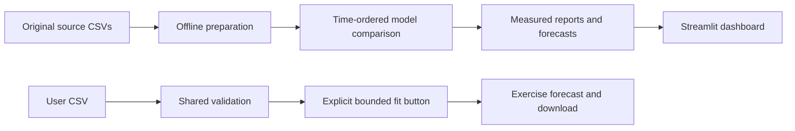
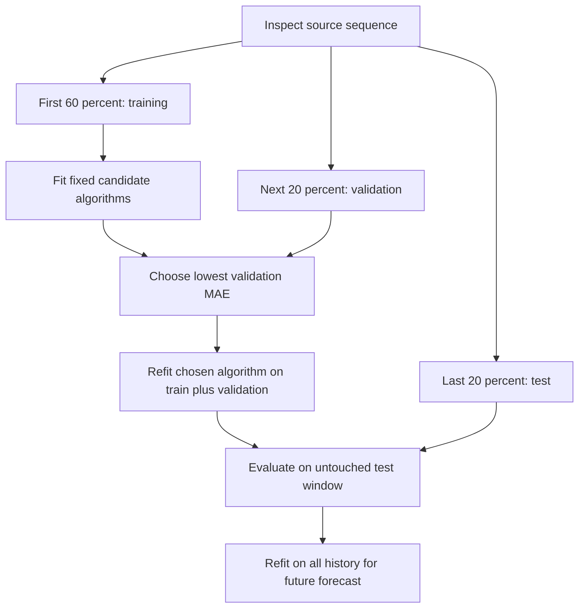
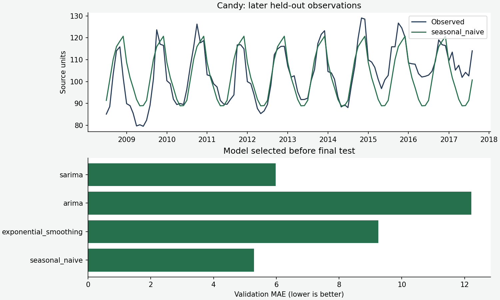
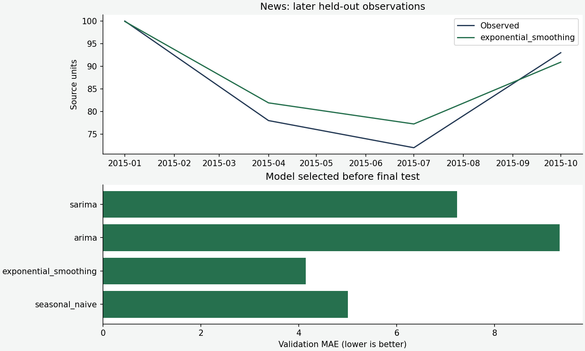

# Forecasting Lab

An end-to-end **time-series learning application** built with Streamlit, pandas, NumPy and statsmodels. Explore two measured historical case studies, compare later-observation errors and fit a bounded forecast to your own CSV—including stock-price observations.

The goal is to learn a reliable sequence: inspect history, preserve time order, compare simple and more complex models, test on later observations, and then forecast beyond the known history. A complicated model does not automatically win.

> Historical educational examples. Built-in data ends in 2017 for candy and 2015 for quarterly news demand. Forecasts begin after those source cutoffs, not today. No trading recommendation or business-planning accuracy guarantee is implied.

[Run locally](#run-locally) · [Use the app](#use-the-application) · [Algorithms](#algorithms-and-their-tradeoffs) · [Results](#measured-results) · [Deployment](#deployment-on-streamlit-community-cloud)

## What the app contains

| Area | What you can do |
|---|---|
| History and forecast | Select candy or quarterly demand, inspect history, choose 1–24 future observation steps and download forecasts |
| Evaluation | Compare validation errors, inspect final held-out actual-versus-forecast lines and see any failed candidate fits |
| Try your CSV | Upload date/value observations, select an algorithm/season length, fit a bounded exercise and download it |
| Understand the flow | Read the sequence, model intuition, error definitions and limitations |

The stock-study notebook and PDF are preserved. A verified stock-price CSV is not bundled; the custom CSV interface is the working path for stock-price exercises. It does not fabricate market data or call a live finance API.

Original notebooks and datasets remain in their source folders. Some notebook cells were incomplete or used old APIs; the application uses the new tested modules rather than executing notebook state at startup.

## Architecture



Default views load precomputed, reproducible reports, so the dashboard does not retrain just because someone opens it. A custom upload runs a bounded fitting exercise only after the visitor selects its button. Domain functions are separate from the Streamlit interface, allowing meaningful tests without clicking through a browser.

## Run locally

Use Python **3.10 or 3.11**; choose 3.11 for Community Cloud. Pinned dependencies are declared in `pyproject.toml` and installed through `requirements.txt`.

```bash
git clone https://github.com/subhashdixit/time-series-forecasting-lab.git
cd time-series-forecasting-lab
python3 -m venv .venv
source .venv/bin/activate
python -m pip install --upgrade pip
pip install -r requirements-dev.txt
python -m pip check
streamlit run streamlit_app.py
```

On Windows, use `.venv\Scripts\Activate.ps1`. Open the local URL Streamlit prints, normally [http://localhost:8501](http://localhost:8501). Default reports are committed; source preparation is optional for ordinary app use.

## Use the application

1. Choose **Candy production** or **Quarterly news demand** in the sidebar.
2. Inspect the source history and its last observed date.
3. Choose the future horizon in **observation steps**. Candy steps are monthly; quarterly-demand steps are quarterly.
4. Open **Evaluation** to understand how the chosen model performed on later held-out observations.
5. Download the visible forecast.
6. To study your own data, open **Try your CSV**, upload it, select the algorithm and season length, then choose **Fit exercise forecast**.

Custom CSV contract:

```csv
date,value
2020-01-01,100.0
2020-02-01,103.5
2020-03-01,101.2
```

The snippet illustrates the format, not enough training history. Upload 12–1,200 observations, maximum 1 MiB, with unique strictly increasing dates and finite numeric values. Missing values, duplicate dates and silent sorting are rejected. Download the complete built-in input example for a valid starting file.

Season length is observations per cycle: 12 for monthly yearly seasonality, 4 for quarterly yearly seasonality, or 1 for no seasonal cycle. Fitting requires at least two cycles and six observations. An arbitrary large season on a short series fails clearly rather than producing a claimed successful forecast.

Irregular stock-trading dates are interpreted as **ordered observations**, not an invented continuous calendar. Forecast output uses `future_step` rather than guessing holidays or market sessions. A custom fit has no independent measured test score; reserve later observations before judging its quality.

Uploaded data is processed in memory and is not written by the app. Use data you are authorized to analyze. The service does not provide user authentication, durable private storage or a production forecasting SLA.

## Data and units

| Source | Observations | Period | Column interpretation |
|---|---:|---|---|
| Candy source CSV | 548 | Monthly, January 1972–August 2017 | Source `IPG3113N` series; use its source units, not an invented tonnage unit |
| Quarterly news-demand source | 16 | Q1 2012–Q4 2015 | Supplied demand values; units are not independently documented |
| Stock notebook/PDF | Preserved study | Historical notebook | Upload your own verified date/value price series for the app exercise |

The quarterly source combines year and quarter into a quarter-start date. Original TRP episode data is retained as source material, but is not silently treated as a dated quarterly series. Files do not establish complete upstream collection or licensing provenance; verify rights before redistributing source materials elsewhere.

## Reproduce preparation

```bash
python scripts/prepare.py
```

Preparation writes each source history, held-out forecast, 24-step future forecast and JSON evaluation into `reports/`. Source SHA-256 hashes are recorded. The app serves those files; there are no opaque saved pickle models to load from users.



The exact counts are **328/110/110** for candy and **9/3/4** for quarterly demand. Time order is preserved; there is no shuffled train/test split. The chosen method is refitted on development data before final testing. Only after recording the test result is the final future forecast refitted on all known history.

The test is a single historical cutoff, not rolling-origin cross-validation or independent future evidence. Repeatedly modifying settings after viewing test errors would reuse the test and weaken that claim. For real forecasting research, add rolling-origin evaluations and fresh later periods.

## Algorithms and their tradeoffs

| Algorithm | Story | Advantage | Limitation |
|---|---|---|---|
| Seasonal naive | Repeat the last observed cycle | Transparent, fast and difficult to beat when seasonality dominates | Cannot adapt a changing trend or new regime |
| Exponential smoothing | Estimate level, trend and additive seasonality | Useful for smoothly evolving seasonal structure | Trend extrapolation can diverge over long horizons; structural breaks are difficult |
| ARIMA(1,1,1) | Difference once, then model lagged dynamics and errors | Compact statistical baseline | Fixed order, stationarity assumptions after differencing and no explicit seasonal cycle |
| SARIMA(1,1,0) × (1,0,0,s) | Add a seasonal lag to differenced dynamics | Models repeated seasonal dependence | More parameters, optimization sensitivity and weak estimates on short histories |

The orders are deliberately fixed, not an exhaustive search. With season 1, the seasonal component is disabled. ARIMA/SARIMA optimizer iterations are bounded; non-convergent fits are excluded and reported. A warning about starting parameters is not automatically the same as failed convergence.

**Why this sequence?** Start with the simplest credible baseline. Add trend/seasonality smoothing when the pattern changes smoothly. Add autoregressive/differencing structure when residual dependence suggests it. Compare held-out errors rather than assuming a newer or more complex model must be better.

A simple analogy: seasonal naive repeats last year's calendar; smoothing revises that calendar gradually; ARIMA models how changes depend on previous changes and surprises; SARIMA adds the repeating seasonal rhythm.

## Measured results

| Case | Rows | Validation-selected model | Test MAE | Test RMSE | Test rows |
|---|---:|---|---:|---:|---:|
| candy | 548 | seasonal naive | 5.871 | 7.505 | 110 |
| news | 16 | exponential smoothing | 2.833 | 3.437 | 4 |





Candy's seasonal-naive validation MAE is 5.293, compared with 9.254 for smoothing, 12.216 for ARIMA and 5.977 for SARIMA. The simplest candidate wins this particular comparison. Quarterly demand selects smoothing by validation MAE 4.143, but its final test contains only four observations; the result is not robust evidence for planning.

**MAE** averages absolute errors in source units. **RMSE** squares errors before averaging and taking a square root, so large misses count more heavily. If errors are 10 and 20 units, MAE is 15 and RMSE is about 15.81. Neither permits a fair direct comparison between unrelated source scales. MAPE is not included because percentage errors become unstable near zero and need a separate suitability decision.

No calibrated prediction intervals are claimed. Forecasts are not silently clipped to positive values; statistical models can produce implausible values, which is a limitation to inspect rather than conceal. Long horizons on a short series are especially unreliable.

## Tests and coding standards

```bash
python -m black --check src tests scripts streamlit_app.py
python -m pylint src scripts streamlit_app.py
python -m pytest -q
python -m pip check
```

Tests check input bounds, dates, duplicates, missing/non-finite values, seasonal-naive arithmetic, MAE/RMSE definitions, held-out selection independence and both rendered dashboard examples using Streamlit AppTest. One test changes only final test observations and confirms that validation selection does not change.

The code uses focused functions rather than forcing a stateful class around stateless calculations. Streamlit handles presentation; `forecasting.core` owns validation, fitting and evaluation. File preparation is a separate script. This separation is more useful than a large inheritance hierarchy for this application.

## Deployment on Streamlit Community Cloud

Hosting provides the running process and public URL. Deployment installs a specific repository revision into that environment. Community Cloud connects to GitHub, installs the project and runs the entry file.

1. Sign in to Community Cloud and connect GitHub.
2. Create an app from `subhashdixit/time-series-forecasting-lab`.
3. Select branch `main`, entry file `streamlit_app.py` and Python **3.11**.
4. Deploy and inspect installation logs.
5. Open both built-in examples and test a forecast download.

Community Cloud is free with platform resource limits and sleep behavior. Default precomputed views reduce startup work; custom model fitting is bounded, but concurrent visitors can still contend for resources. See [Community Cloud documentation](https://docs.streamlit.io/deploy/streamlit-community-cloud).

### CI and platform-managed deployment

GitHub Actions checks Python 3.10/3.11, formatting, Pylint, tests and the container health endpoint. Pull requests should pass before merging. Community Cloud watches the published branch and manages deployment; this is **CD**, even though we do not build a custom deployment action. It does not provide Render's explicit after-checks deployment switch; merge discipline and branch checks matter.

Benefits are fast publication and little server configuration. Tradeoffs include platform limits, less server control and reliance on the provider's GitHub integration. A failed dependency install is a deployment problem; a healthy app with weak forecasts is a modeling problem. Monitor them separately.

## Optional Docker execution

```bash
docker build -t forecasting-lab:local .
docker run --rm -p 8501:8501 forecasting-lab:local
```

The image packages Python, dependencies, source and prepared reports. It runs as a non-root user. Docker makes packaging portable but adds image/build maintenance; Community Cloud deployment uses its native Python environment instead.

## Versioning and rollback

Git identifies code and prepared artifacts. Each JSON report records its source hash and evaluation. Re-running preparation changes the forecast release; opening the dashboard does not. Review model/code/report changes together and retain the previous revision.

Rollback means reverting the problematic commit through a reviewed change and allowing the platform to publish the restored branch. Merely restarting a broken revision does not restore an earlier model. If the test cutoff influences repeated tuning, reserve new later data before claiming an untouched evaluation.

## Repository map

```text
src/forecasting/core.py  validation, algorithms, errors and chronological selection
streamlit_app.py        dashboard and bounded CSV exercise
scripts/prepare.py     source-to-report offline preparation
scripts/plot_results.py reproducible documentation figures
reports/               measured JSON reports and forecast/history CSVs
tests/                 domain and AppTest checks
.streamlit/            theme and upload limits
.github/workflows/     CI; platform manages deployment separately
Dockerfile             optional portable runtime
Candy_Production/      original source CSV and notebook
NEWS_Demand_Dataset/   original quarterly/TRP data and notebook
Happiest_Mind_Stock_Price_Prediction/ original stock study
```

## Troubleshooting

A short-series or season-length error means the chosen fit lacks enough history; reduce season length or supply more observations. A non-convergence error is a failed fit, not a valid forecast. Correct dates and missing values explicitly rather than silently interpolating test targets. If Cloud imports fail, confirm Python 3.11 and that `requirements.txt` installs this package from the repository root.

## References

- [Statsmodels time-series models](https://www.statsmodels.org/stable/tsa.html)
- [Streamlit AppTest](https://docs.streamlit.io/develop/api-reference/app-testing)
- [Streamlit Community Cloud](https://docs.streamlit.io/deploy/streamlit-community-cloud)
